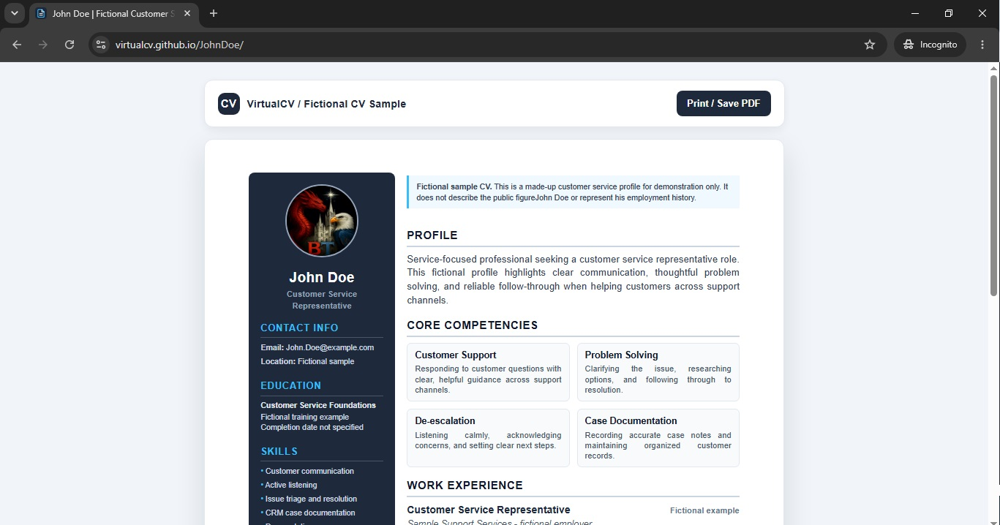

# VirtualCV

VirtualCV hosts candidate CVs as static pages on GitHub Pages. Candidates can build and download a CV first, then request that it be published here as a personalized online page.

## Create and host a CV

1. Open the [PhoenixFlix CV builder](https://phoenixflix.vercel.app/CVbuilder).
2. Click the sample text to edit it, add a profile photo, and review the completed CV.
3. Download a standalone HTML copy or print and save the CV as a PDF.
4. To request online hosting, email the standalone HTML file to [The VirtualCV team](mailto:ThePhoenixFlix@gmail.com?subject=VirtualCV%20online%20hosting%20request).
5. After the page is published, share its direct link with recruiters.

The builder is maintained separately from this repository. Drafts are saved locally in the candidate’s browser and are not uploaded automatically.

### CV builder preview

[Open the CV builder](https://phoenixflix.vercel.app/CVbuilder).


### Example hosted CV

[View the sample CV online](https://virtualcv.github.io/JohnDoe/).



## Published pages

- [VirtualCV landing page](./index.html)
- [Ben Tran interactive portfolio](./BenTran/)
- [Ben Tran CV](./BenTran.html)
- [John Doe sample CV](./JohnDoe/)

Root-level CV files and profile folders are separate pages. Update the intended page and its associated assets when editing a profile.

## Repository layout

```text
.
├── index.html
├── favicon.svg
├── images/
│   ├── CVbuilder.jpg
│   └── onlineCV.jpg
├── BenTran/
│   ├── index.html
│   ├── Certificates/
│   ├── Resumes/
│   └── images/
├── JohnDoe/
│   ├── index.html
│   └── images/
└── Save/
```

## Preview locally

Open `index.html` in a browser or run a static web server from the repository root. The CV builder link opens the separately hosted PhoenixFlix tool.
