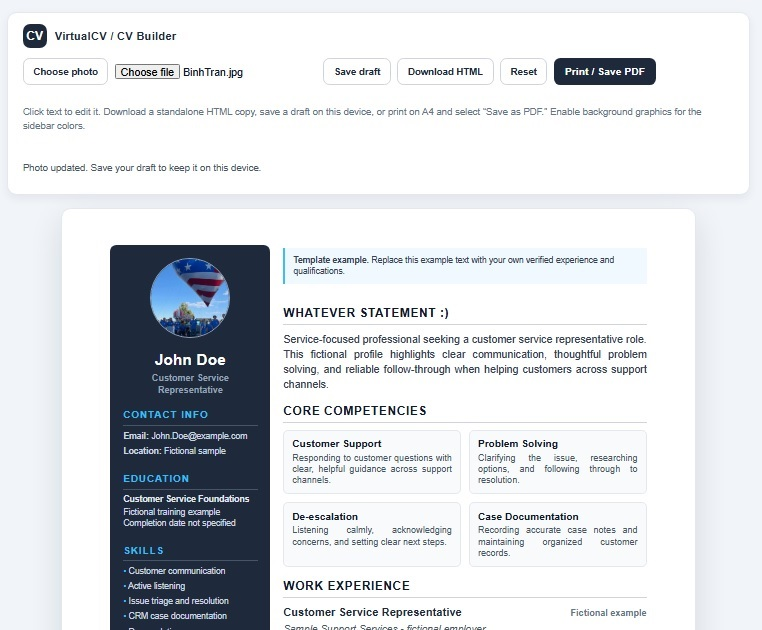

# VirtualCV

VirtualCV is a static resume-hosting site published with GitHub Pages. Candidates can create and download a CV using the builder hosted on PhoenixFlix, then request a personalized page hosted here.

## Candidate workflow

1. Open the [CV builder](https://phoenixflix.vercel.app/CVbuilder), edit the sample content, and add a profile photo.
2. Download the finished CV as HTML or print/save it as a PDF.
3. Email the standalone HTML file to [The VirtualCV team](mailto:ThePhoenixFlix@gmail.com?subject=VirtualCV%20online%20hosting%20request) to request online hosting.
4. Once published, share the candidate’s direct page link with recruiters.

The builder saves drafts locally in the candidate’s browser. Drafts are not uploaded automatically.

## Published pages

- [VirtualCV landing page](./index.html) explains how candidates build a CV and request hosting.
- [Ben Tran portfolio](./BenTran/) is an interactive portfolio.
- [Ben Tran CV](./BenTran.html)
- [JohnDoe CV](./JohnDoe.html)
- [JohnDoe printable CV](./JohnDoe/)

The root-level HTML files and profile folders are independent pages. Update the intended page and its associated assets when editing a profile.

## Repository layout

```text
.
├── index.html
├── favicon.svg
├── images/
│   └── CVbuilder.jpg
├── ProfilePics/
├── BenTran.html
├── BenTran/
│   ├── index.html
│   ├── Certificates/
│   ├── Resumes/
│   └── images/
├── JohnDoe/
│   ├── index.html
│   ├── JohnDoe.html
│   └── images/
└── Save/
```

The CV builder is maintained separately at `phoenixflix.vercel.app/CVbuilder`; it is not part of this GitHub Pages repository.



## Preview Sample CV Online
https://VirtualCV.GitHub.io/JohnDoe


